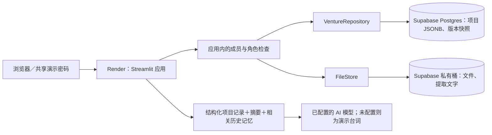

# AIN Virtual EIR：云端部署与交接

这套部署包为现有 Streamlit 应用提供 Render 运行配置、Supabase Postgres 项目存储和 Supabase 私有文件桶。代码仍使用 `VentureRepository`、`FileStore` 两个接口，页面不直接访问数据库。

这里的配置和脚本可用于部署；**创建配置文件不代表部署成功**。上线验收还需要真实账号、云端项目、部署网址和实测记录。演示使用虚构项目，演示账号选择器和共享密码不等于学校单点登录或正式的个人身份认证。

## 1. 架构与数据流



所有 Supabase 高权限密钥留在 Streamlit 服务端。数据库表启用 RLS，匿名角色和普通登录角色没有直接读取这些表的权限；应用服务通过后端密钥操作。该设计的团队权限由应用执行，不应描述为已实现 Supabase Auth 或按真实用户执行数据库 RLS。

项目保存使用版本号检查。同一版本的两个副本中，先保存的一份成功，后一份收到冲突；系统不自动把旧内容覆盖到新版本上。`eir_venture_versions` 保存每次成功写入的快照，它帮助追溯和恢复记录，但不能替代云平台的灾难恢复备份。文件原件和提取文字需要单独备份。云端文件版本不可覆盖；从界面移除附件会删除项目中的引用并保留私有文件，避免并发操作或历史快照失去原件。实际清理存储需要管理员确认保留策略后执行，不能把界面移除描述成彻底擦除。

## 2. 准备账号和服务

需要 GitHub 仓库、Supabase 项目和 Render 账号。可以使用学校已有的服务；先确认团队成员中谁拥有这些账号，谁在展示后继续维护。此 Blueprint 选择 Render Free，不自动创建付费实例。

当前已部署的实例为学生个人账号下的演示环境，AIN Center尚未接管。交付源代码、数据库初始化脚本、私密配置清单和测试证据，可支持接收方在自己的账号下重建演示。正式接管前需由AIN Center指定账号所有者、费用负责人和维护负责人，并约定学生团队支持期限。若需要保留现有云端数据及文件，还需制定并验证迁移与切换步骤；当前演示环境不代表已完成机构账号交接或正式运营验收。

Render Free 有休眠、资源和使用额度限制，不应当承诺生产级持续在线；展示前应提前打开网址预热。云端文件和项目记录放在 Supabase，不依赖 Render 的临时本地磁盘。[Render Free 官方说明](https://render.com/docs/free)

建议仓库根目录直接使用 `virtual_eir/` 的内容，使 `app.py`、`requirements.txt` 和 `render.yaml` 位于仓库根目录。如果上传整个外层文件夹，在 Render 中将 Root Directory 设为 `virtual_eir`；使用 Blueprint 时也要给服务加入 `rootDir: virtual_eir`，并选择 `virtual_eir/render.yaml` 作为 Blueprint 路径。[Render Blueprint 配置](https://render.com/docs/blueprint-spec)

## 3. 初始化 Supabase

1. 创建一个专用于虚构演示数据的 Supabase 项目。
2. 在 SQL Editor 中执行仓库内 `deploy/supabase.sql`。它创建项目表、版本快照、原子保存函数和 `eir-files` 私有桶。
3. 在项目设置中取得项目 URL 和后端 Secret key；也兼容旧版 `service_role` key。不要选择供浏览器使用的 publishable/anon key 作为本应用后端密钥。
4. 确认 `eir-files` 的 Public 开关关闭。私有桶读取需要经过鉴权，不应给团队上传的文件创建公开访问策略。[Supabase 私有桶说明](https://supabase.com/docs/guides/storage/buckets/fundamentals)

SQL 不会导入学生资料，也不会默认开放匿名访问。不要为解决权限报错而关闭 RLS 或给匿名角色开放全部记录。后端密钥绕过 RLS，因此只能放在服务器配置中。[Supabase 数据库 RLS](https://supabase.com/docs/guides/database/postgres/row-level-security)

## 4. 配置变量

在 Render 的 Environment 中填写，或在本机用户目录 `~/.streamlit/secrets.toml` 中配置。不要把真实值写进 GitHub、命令行参数或交付压缩包。

| 变量 | 值／作用 |
|---|---|
| `EIR_STORAGE` | `supabase`，明确启用云端持久化 |
| `SUPABASE_URL` | 项目 HTTPS URL |
| `SUPABASE_SECRET_KEY` | 服务端 Secret key；旧版 key 可使用 `SUPABASE_SERVICE_ROLE_KEY` |
| `SUPABASE_BUCKET` | 默认 `eir-files`，与 SQL 中的私有桶一致 |
| `EIR_DEMO_PASSWORD` | 团队约定的共享演示密码；云模式必须配置 |
| `LLM_PROVIDER` | 真实 AI 接口提供者；可沿用项目原有配置 |
| `LLM_API_KEY` | 已获准使用的模型密钥；未配置时运行演示台词 |
| `LLM_MODEL` | 该密钥可访问的模型名称 |
| `LLM_BASE_URL` | 使用兼容接口时填写；使用默认接口时按原项目配置 |

本机配置示例仅含占位符：

```toml
EIR_STORAGE = "supabase"
SUPABASE_URL = "https://YOUR_PROJECT.supabase.co"
SUPABASE_SECRET_KEY = "REPLACE_IN_PRIVATE_SETTINGS"
SUPABASE_BUCKET = "eir-files"
EIR_DEMO_PASSWORD = "CHOOSE_A_PRIVATE_DEMO_PASSWORD"
```

`cloud_check.py`、`migrate_cloud.py` 和 `restore_cloud.py` 支持环境变量，或通过 `--secrets /absolute/path/secrets.toml` 指定本地配置文件。与应用保持一致，配置文件优先于环境变量：未显式指定文件时，项目本地 secrets 覆盖用户目录 secrets，缺失项才从环境变量补充。脚本不打印密钥、原始云端响应或项目聊天内容。

## 5. 检查连接并导入虚构数据

以下命令在仓库根目录 `virtual_eir/` 中运行，先完成依赖安装。激活虚拟环境后使用 `python`；Windows 和 macOS 均可。

```bash
python scripts/cloud_check.py
python scripts/migrate_cloud.py --seed-demo
python scripts/migrate_cloud.py --seed-demo --apply
python scripts/cloud_check.py --write-test
```

第一条只读检查数据库和桶。第二条只列出计划，不连接云端、不写入。第三条显式导入捆绑的虚构项目。已有同名项目会跳过，不会覆盖会议前的项目进展；`seed:` 文件保留为随代码部署的只读演示文件。最后一条测试写入、重新读取、旧版本拒写和文件校验；临时文件会删除，带有 `V-CLOUDCHECK-` 前缀的验证项目和版本快照会保留供检查。

迁移已有本地项目时必须明确选择两个目录：

```bash
python scripts/migrate_cloud.py --source-dir /absolute/path/ventures --files-dir /absolute/path/files
python scripts/migrate_cloud.py --source-dir /absolute/path/ventures --files-dir /absolute/path/files --apply
```

脚本不默认扫描用户目录。它只复制项目记录引用的文件，检查原文件 SHA256，重新读取云端文件校验内容，并比较保存后的项目数据。中途失败可以重新运行：相同对象会复用，已存在项目跳过，不同内容的已有文件不会被脚本主动覆盖。已上传但未写入项目记录的孤立文件需要管理员在排查后清理；该流程不是跨数据库和文件桶的全局事务。

## 6. 部署原应用

在 Render 新建 Blueprint，连接已推送代码的 GitHub 仓库，选择本文件包中的 `render.yaml`，填入上述私密配置。也可以创建 Python Web Service 并手动配置：

```text
Build Command: pip install --disable-pip-version-check -r requirements.txt
Start Command: python -m streamlit run app.py --server.address 0.0.0.0 --server.port $PORT --server.headless true --browser.gatherUsageStats false
Health Check Path: /_stcore/health
```

服务必须绑定 `0.0.0.0` 和 Render 提供的 `PORT`。[Render Web Services](https://render.com/docs/web-services)

等待 Render 显示部署成功，再打开实际返回的 `onrender.com` URL。健康检查只说明 Streamlit 服务在线；还必须通过共享密码进入，选择 Alice，打开 Campus Loop，确认数据库读取、一次保存和文件下载都正常。不要只根据健康检查判定云存储通过验收。

如果用 Docker，在 `virtual_eir/` 目录构建 `Dockerfile`。构建上下文会排除真实 secrets、本地数据和缓存。通过运行环境提供云配置；不把密钥编入镜像。容器默认端口 8501，也接受 `PORT`。

## 7. 从项目版本快照恢复

恢复工具先读取指定历史版本并检查其文件引用、原文件校验和与提取文字。默认仅显示计划；`--apply` 把旧内容保存为一个新的版本，不删除或改写已有版本历史。下面示例中的版本号需要替换为实际值。

```bash
python scripts/restore_cloud.py --venture-id V-CAMPUS --revision 2
python scripts/restore_cloud.py --venture-id V-CAMPUS --revision 2 --expected-current-revision 5 --apply
```

第一条是只读预览，会显示当前版本。第二条把预览中的当前版本作为前提；如果已有其他人更新项目，则拒绝恢复，要求重新审查计划。真正保存前后之间的并发修改也会被数据库版本检查拒绝。恢复后重新读取验证保存结果；恢复附件引用依赖保留的私有文件仍然存在。

该操作恢复整个项目快照，包括成员、对话、任务与文件引用。执行者应在团队约定的维护时段操作，并记录所选旧版本、恢复后的新版本和原因。项目快照不能恢复已被管理员物理清除的文件；遇到缺失文件，工具会停止，必须先从外部备份恢复文件原件。

## 8. 上线验收记录

在实际执行后填写，不要提前标为通过：

| 验收项 | 需要留下的证据 | 初始状态 |
|---|---|---|
| Render 部署成功 | 实际服务网址、部署时间、对应提交版本 | 待执行 |
| Supabase schema 与私有桶 | SQL 成功记录、`cloud_check.py` 输出 | 待执行 |
| 项目跨会话保存 | 浏览器A保存，浏览器B刷新后显示同一内容 | 待执行 |
| 文件云端持久化 | 上传后重新登录，仍可下载且内容一致 | 待执行 |
| 并发写保护 | 旧版本保存得到冲突提示，新版本不丢失 | 待执行 |
| 快照恢复 | 指定旧版被恢复为新版本，原历史保留，文件完整 | 待执行 |
| AI 历史记忆 | 真实模型回答使用相关旧对话，来源可追溯 | 待执行；需要模型访问 |
| 演示模式 | 无模型密钥时仍可完成预设演示 | 待执行 |

遇到问题先检查：服务根目录、Python 依赖、Render 日志、`EIR_STORAGE`、Supabase URL/后端密钥、SQL 是否执行、桶是否为私有。不要把含密钥的配置或原始项目数据粘贴到公开问题单。

展示前记录当前已通过的测试、打开并预热服务、确认虚构数据可以恢复，并按 `docs/DEMO_MEMORY_CLOUD.md` 演练一次。
