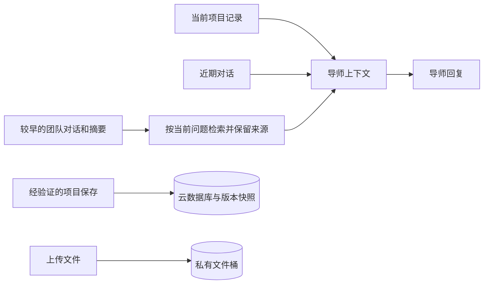

# 记忆机制与云端存储交付记录

日期：2026-11-16。目标：2026-11-20（周五）前完成可展示的原型和真实云端部署。

基础记忆与云端演示场景已通过：任务读写、已配置的真实AI回复、云端聊天、Bob无痕会话近期上下文回忆、带来源查找，以及单个773字节TXT文件的私有上传、内容读取和原件下载校验。长窗口真实检索、正式账号认证、灾难备份和AIN完整交接不在本次基础演示通过范围内。金额显示修复已在本地完成并验证，部署仍待完成。

## 当前可展示的内容

1. 原来的四个工作页面继续可用；在 Menu → Project memory 可以查看当前记录、搜索带日期和发言人的历史内容、查看每日摘要、导出项目记录。
2. AI 上下文补充与当前问题相关的较早团队消息或日摘要。原有近期窗口为30条／16,000字符；新增检索最多提供5段、合计4,000字符。支持中英文关键词，不额外调用模型或向量服务。
3. 当前项目记录优先于历史说法。检索到的内容保留来源，不会自动升级为证据；顾问和练习原始对话不进入此检索，IP敏感项目关闭历史片段检索。
4. 无API密钥时仍可演示来源检索和脚本导师的回忆回答。真实模型如何使用检索结果，需要用小组已有API另行验证。
5. 云端适配器保存项目、对话、摘要和版本快照；文件原件和提取文字进入私有文件桶。过时写入会被拒绝，失败草稿可以下载；不会悄悄切回本地保存。
6. 上传中断不会留下空文件记录，版本保存失败后仍能重新上传。界面移除附件会保留私有文件，以支持恢复旧版本；永久清理需要单独管理。
7. 已准备数据库初始化、数据迁移、云端检查、历史恢复、Render和Docker配置。迁移和恢复默认只预览，明确执行时才写入。

## 实际验证与未完成项

| 项目 | 状态与边界 |
|---|---|
| 原有功能与新增逻辑的自动化测试 | **303项通过，0失败**，29.81秒；完整结果见 [测试报告](validation-memory-cloud.xml)；无真实云账号、无真实模型请求 |
| 本地Streamlit启动 | 已启动，`/_stcore/health` 返回 HTTP 200 / `ok` |
| 页面操作 | Streamlit AppTest验证登录、菜单、检索、访问密码、失败草稿与创建重试；用户已在部署网站解锁、打开Campus Loop并创建任务，详见下方真实云端验收记录 |
| 云适配器、并发和文件版本 | 真实Supabase数据库的初次保存、二次保存、旧版本拒写和版本归档已验证；临时测试事务已回滚。部署应用的HTTP适配器已完成项目读取、任务写入和聊天持久保存；版本5时的六条聊天消息与归档、上传文件后的版本7均由独立数据库查询确认 |
| 单文件上传、讨论与下载 | `Cedar_Pilot_Plan.txt`经部署应用上传并点击Discuss，AI正确读取计划与尚无结果的边界；私有原件、提取文字、大小和校验值均已确认。用户报告按要求完成新会话原件下载；`Cedar_Pilot_Plan_DL.txt`与原件均为773字节，SHA-256一致且逐字节相等。通过范围仅为此TXT文件 |
| 迁移与恢复 | 经用户明确授权，Campus Loop和LumaSense两个内置虚构项目已导入个人云数据库，初始化时完整JSON与本地种子数据逐项一致；历史恢复演示与灾难备份尚未验收 |
| Docker镜像 | 配置已准备；本机没有Docker，未实际构建镜像 |
| GitHub与云账号 | 三个平台均已连接。源代码已上传到个人账号下的私有仓库bboisad/ain-virtual-eir。Render已获仓库授权，My Workspace中的免费服务ain-virtual-eir-demo已达到live；后端访问与演示密码已由用户私密配置，部分功能验收已通过 |
| 真实AI对话 | 用户已在部署环境私密配置OpenAI与`gpt-5.6-luna`；真实模型成功回复，并在Chrome无痕会话以模拟成员Bob Lee正确回忆Cedar计划的六项事实。六条聊天消息及最新归档均由独立数据库查询确认；尚不证明长历史检索或正式账号认证 |
| 来源查找界面 | Menu → Project memory使用小写`cedar`已返回带成员、时间和Source ID的消息卡片，三个来源ID与独立数据库查询一致；金额原文显示问题已在本地用`st.text`修复，针对性界面测试1项通过（1.68秒），尚未部署 |
| 公开可访问的部署网址 | https://ain-virtual-eir-demo.onrender.com 已部署为live，首页与健康检查均返回HTTP 200；基础记忆与云端演示场景已通过，包括单个TXT文件的上传、讨论与原件下载校验；金额显示修复部署、长窗口检索和完整交接仍待完成 |

这版是使用虚构项目的完整演示扩展，保留共享密码和演示身份。共享密码不区分真实个人，应用内团队权限也不等于学校身份认证。

当前GitHub仓库、Supabase项目和Render服务属于学生个人账号下的演示环境，尚未移交AIN Center。交付包已包含源代码、数据库初始化与部署配置，可供接收方在自己的账号下重建演示。AIN Center的正式环境、接收负责人、费用归属、维护期限和最终验收范围尚待双方确认；当前个人云端部署不代表这些事项已经完成。

## 上线配置与剩余输入

- 已确认的私有GitHub仓库：`bboisad/ain-virtual-eir`，源代码以仓库根目录部署。
- Supabase项目、Render的My Workspace和免费实例范围均已确认，标识见 `deploy/cloud-target.json`。创建账号、接受服务条款或需要付款的动作由账号持有人处理。
- Supabase后端密钥与团队约定的演示访问密码已由用户私密填写，部署应用的实际访问与保存已验证。
- 用户已私密配置`LLM_PROVIDER=openai`、`LLM_MODEL=gpt-5.6-luna`及`LLM_API_KEY`，真实模型回复已观察到；密钥不在聊天和仓库中传递。

Render读取仓库的权限问题已解决。用户已直接在Render服务的Environment私密设置`SUPABASE_SECRET_KEY`、`EIR_DEMO_PASSWORD`与模型配置，基础记忆与云端演示场景已通过。服务详情见`deploy/cloud-target.json`；金额显示修复已在本地验证、尚待部署。长窗口真实检索、正式账号认证、其他文件格式、停机恢复、灾难备份和完整接收方交接尚未验证。

逐步填写方法见 [线上私密配置](PRIVATE_CONFIGURATION.md)。不要只凭Render显示live或健康检查成功就声称应用、模型和云存储全部完成验收。

后续部署、迁移与恢复按 [部署与恢复说明](CLOUD_DEPLOYMENT.md) 执行，并持续记录实际验收结果。不要把此页的待验收项提前改成通过。

## 2026-11-16真实云端验收记录

- 任务验收时，Render免费服务`srv-dbtn61jm8hqs73cvbno0`的部署`dep-dbtqpikipgvc739sk4lg`已确认为`live`，提交为`a4a27bbcfacdcc936ddc03929e7b3422ce90beed`。
- 用户在部署网站成功解锁并打开Campus Loop，通过应用界面创建任务：
  > Summarize the $3 prepaid listing test with 10 students: record how many paid, their reasons for declining, and whether at least 4 students paid.
- 独立Supabase查询确认：`V-CAMPUS`从基线版本1增至版本2，`updated_at`为`2026-11-17 02:15:02.328238+00`（纽约时间11月16日21:15:02），归档数为2。新增任务`S-08919d1860a5`的实际负责人为`team`、到期日为`2026-11-16`、状态为`open`、创建人为`m1`；原计划中的Alice／11月20日并非此次保存值。
- 版本2的归档内容与当前内容完全一致；版本1不存在该任务，`V-LUMA`中匹配任务数为0。这些查询确认此次归档一致且任务未写入另一个项目，不代表完整的界面授权或项目隔离验收。
- 该轮验证部署应用通过云适配器读取项目并写入任务；完整验收仍未完成。后续真实模型和跨会话回忆结果见下文，长历史检索与文件上传下载仍待验收。

## 2026-11-16 22:14纽约时间：真实模型与聊天保存

- 用户私密配置OpenAI模型后，Render最新部署`dep-dbts45rl550s7396l2l0`已确认为`live`，提交仍为`a4a27bbcfacdcc936ddc03929e7b3422ce90beed`。配置的提供商为`openai`，模型为`gpt-5.6-luna`；本记录不包含密钥。
- 用户截图显示，部署网站已针对新的Cedar虚构试点计划返回成功的非脚本一句话回复。原始消息为：
  > For our demo project, Alice will lead the Cedar pilot on November 20, 2026, with a $36 budget. We plan to recruit 10 students for the $3 prepaid listing test. No results have been collected yet. Please summarize this plan in one sentence.
- 实际回复为：
  > Alice will lead the Cedar pilot on November 20, 2026, using a $36 budget to recruit 10 students for the $3 prepaid listing test, with results still pending.
- 独立Supabase查询确认`V-CAMPUS`版本3共保存两条聊天消息：`m1`原消息`ce3d95d5-9a88-4691-99e7-13ec8d23e4b9`时间为`2026-11-17T03:14:35Z`，`eir`回复`ffd63708-47e5-4dba-9490-f687df89fbb6`时间为`2026-11-17T03:14:38Z`；最新归档内容与当前内容完全一致。
- 此次通过范围为真实模型成功回复和云端聊天持久保存。两条消息仍在近期上下文窗口内，不能作为长历史检索证据；后续跨会话回忆结果见下一节。

## 2026-11-16 22:21纽约时间：跨会话模拟成员回忆

- 用户提供两张截图：先在普通Alice会话中回忆，再于明确显示为Chrome无痕模式的新会话中，以模拟成员Bob Lee提问。Bob原问题为：
  > What did we previously decide about the Cedar pilot? State the owner, scheduled date, budget, target number of students, and listing fee. Have any results been collected? Use only saved project information, and do not modify any records.
- 截图与独立Supabase查询均确认回复的六项事实正确：负责人Alice、日期2026年11月20日、预算36美元、目标10位学生、每条上架费3美元、尚未收集结果。
- `V-CAMPUS`达到版本5，共保存六条聊天消息。Bob消息作者为`m2`、ID为`7d249a45-93e6-445e-95ec-2ead80f5bb97`、时间为`2026-11-17T03:20:59Z`；`eir`回复ID为`d08fbb06-52cf-49f4-bbf3-f32ea928cde4`、时间为`2026-11-17T03:21:01Z`。最新归档内容与当前内容完全一致。
- 与版本3比较，只读回忆提问后`next_steps`、`hypotheses`和`experiments`均未改变；聊天本身按正常流程保存。
- 新浏览器会话读取、模拟第二成员的真实模型回忆和云端聊天持久保存已通过，证明共享云端上下文可跨会话使用。六条聊天仍位于30条近期消息窗口内，尚不证明长历史检索；模拟成员选择也不代表正式账号认证。来源查找的后续结果见下一节；长窗口检索、文件上传下载和完整接收方交接仍待验收。

## 2026-11-16 22:27纽约时间：带来源的界面查找

- 用户截图显示Menu → Project memory以小写`cedar`查询，返回带成员、时间与Source ID的消息卡片；独立Supabase查询确认三个来源ID一致：
  - Bob Lee：`2026-11-17T03:20:59+00:00`，Source `7d249a45-93e6-445e-95ec-2ead80f5bb97`。
  - Alice后续提问：`2026-11-17T03:20:42+00:00`，Source `89c481f6-c17c-42e1-8edf-edbd791f7ab5`。
  - Alice原始计划：`2026-11-17T03:14:35+00:00`，Source `ce3d95d5-9a88-4691-99e7-13ec8d23e4b9`。
- 带来源的界面查找已通过。上述仍为近期保存消息，不能作为超过30条近期消息窗口的长历史检索证据。
- 已观察到显示问题：`st.write`将金额中的`$36 ... $3`解释成数学排版，改变引用文字的显示。后续已在本地改用`st.text`并完成针对性界面测试（1项通过，1.68秒），尚未部署；线上金额原文显示仍未验收。
- 文件上传的后续结果见下一节；长窗口检索和完整接收方交接仍待验收。

## 2026-11-16 22:35纽约时间：私有文件上传与AI讨论

- 用户在部署应用上传`Cedar_Pilot_Plan.txt`并点击Discuss。截图显示AI读取了计划测试、10位学生、每条上架费3美元和4笔预付款目标，并正确保留“尚无实际结果”的边界。
- 独立Supabase查询确认`V-CAMPUS`版本7包含文件`F-46f571`的版本1，上传者`m1`，时间`2026-11-17T03:34:58Z`。原件路径为`V-CAMPUS/F-46f571/v1-3e14b29711f34751a9a7c3d71cfb0f96.txt`，原件773字节，提取文字772字符。
- 文件SHA-256为`d984af6e492d7c6f322bef1edcd54ccb41e0bda6c8f086f4d43a28cdb2919409`，与本地源文件的字节数和校验值一致。`storage.objects`确认原件773字节、同路径追加`.txt`的提取文字对象772字节，均在`public=false`的`eir-files`桶；原件eTag `6d995ebe964fd67e9775fa8731653c12`与本地源文件MD5一致。
- 该轮通过范围为部署应用的真实上传、私有原件与提取文字对象创建、AI读取提取内容并讨论；后续下载校验结果见下一节。

## 2026-11-16：原件下载与单文件完整往返

- 用户报告已按要求在新会话完成原件下载，截图显示下载文件`Cedar_Pilot_Plan_DL.txt`。直接读取下载文件与原始`Cedar_Pilot_Plan.txt`后确认，两者均为773字节、逐字节完全相等，SHA-256均为`d984af6e492d7c6f322bef1edcd54ccb41e0bda6c8f086f4d43a28cdb2919409`。
- 此773字节TXT文件的私有上传、AI内容读取、浏览器原件下载和完整性校验已通过；不代表其他文件格式、停机恢复或灾难备份已验证。
- 基础记忆与云端原型的约定演示场景现已通过。长窗口真实检索、正式账号认证、灾难备份和AIN完整交接仍待后续完成；金额显示修复已本地验证，尚未部署。

## 已完成的Supabase初始化

- 项目：[ain-virtual-eir-demo](https://supabase.com/dashboard/project/mjdfvamdxmqeliaqmjmd)，美国东部区域；组织套餐已确认为Free。
- 数据库表：`eir_ventures`、`eir_venture_versions`；两表开启RLS，匿名角色和普通登录角色均无读取权限，只有后端角色可读取并调用保存函数。
- 文件桶：`eir-files`，已确认私有。
- 演示项目：Campus Loop（3位成员、2个每日摘要、3个假设）与LumaSense（1位成员、1个每日摘要、2个假设），各有1个初始版本。种子数据本来没有聊天消息，未额外制造聊天记录。
- 初始化时校验：两个项目的完整JSON与代码包内种子数据一致；合成临时记录的保存、读取、版本增加和旧版本拒写已通过，随后回滚，没有留下测试项目。
- Supabase性能检查无提示；安全检查有2条信息级“RLS已启用但没有策略”提示，符合此版仅允许服务端后端角色访问的设计。没有为消除提示而开放匿名访问。[提示说明](https://supabase.com/docs/guides/database/database-linter?lint=0008_rls_enabled_no_policy)
- 网站已上线，应用到Supabase的真实HTTP项目读取、任务写入、聊天持久保存及单个TXT文件的私有上传、AI讨论、原件下载校验已通过。数据库后台网址不是应用展示网址。

## 周五前的验收安排

| 节点 | 要交出的结果 |
|---|---|
| 11月16日 | 本地代码、离线测试、云端部署包、演示脚本 |
| 11月17日 | 确认账号与仓库，初始化数据库，生成实际部署网址 |
| 11月18日 | 用真实API、两个独立会话测试记忆、持久保存、上传下载和写入冲突 |
| 11月19日 | 按会议脚本演练，修复实际发现的问题，整理测试证据 |
| 11月20日 | 固定演示版本、记录网址和版本、备份数据、交接源代码与说明 |

以上是项目验收安排，不代表已设置后台定时任务。账号未连接时，真实部署和相关验证仍是交付缺口。

## 会议演示与核心文件

- [5–7分钟演示脚本](DEMO_MEMORY_CLOUD.md)
- [部署、迁移与恢复说明](CLOUD_DEPLOYMENT.md)
- `eir/recall.py`、`eir/memory.py`：检索、上下文和来源。
- `ui/memory_dialog.py`：团队可见的记忆窗口。
- `eir/cloud.py`、`deploy/supabase.sql`：版本化项目保存与私有文件。
- `scripts/migrate_cloud.py`、`cloud_check.py`、`restore_cloud.py`：导入、验收与恢复。
- `render.yaml`、`Dockerfile`：部署入口。

