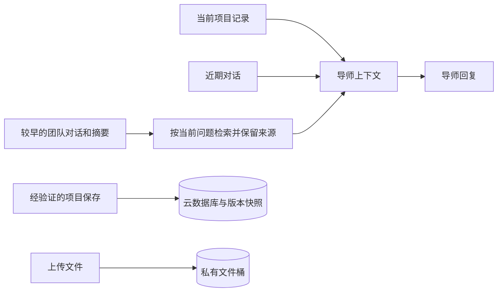

# 记忆机制与云端存储交付记录

日期：2026-11-16。目标：2026-11-20（周五）前完成可展示的原型和真实云端部署。

## 当前可展示的内容

1. 原来的四个工作页面继续可用；在 Menu → Project memory 可以查看当前记录、搜索带日期和发言人的历史内容、查看每日摘要、导出项目记录。
2. AI 上下文补充与当前问题相关的较早团队消息或日摘要。原有近期窗口为30条／16,000字符；新增检索最多提供5段、合计4,000字符。支持中英文关键词，不额外调用模型或向量服务。
3. 当前项目记录优先于历史说法。检索到的内容保留来源，不会自动升级为证据；顾问和练习原始对话不进入此检索，IP敏感项目关闭历史片段检索。
4. 无API密钥时仍可演示来源检索和脚本导师的回忆回答。真实模型如何使用检索结果，需要用小组已有API另行验证。
5. 云端适配器保存项目、对话、摘要和版本快照；文件原件和提取文字进入私有文件桶。过时写入会被拒绝，失败草稿可以下载；不会悄悄切回本地保存。
6. 上传中断不会留下空文件记录，版本保存失败后仍能重新上传。界面移除附件会保留私有文件，以支持恢复旧版本；永久清理需要单独管理。
7. 已准备数据库初始化、数据迁移、云端检查、历史恢复、Render和Docker配置。迁移和恢复默认只预览，明确执行时才写入。

## 实际验证与未完成项

| 项目 | 状态与边界 |
|---|---|
| 原有功能与新增逻辑的自动化测试 | **303项通过，0失败**，29.81秒；完整结果见 [测试报告](validation-memory-cloud.xml)；无真实云账号、无真实模型请求 |
| 本地Streamlit启动 | 已启动，`/_stcore/health` 返回 HTTP 200 / `ok` |
| 页面操作 | Streamlit AppTest验证登录、菜单、检索、访问密码、失败草稿与创建重试；浏览器视觉检查受当前浏览器使用设置限制，未执行 |
| 云适配器、并发和文件版本 | 真实Supabase数据库的初次保存、二次保存、旧版本拒写和版本归档已验证；临时测试事务已回滚。HTTP适配器与真实文件上传下载仍待后端密钥配置 |
| 迁移与恢复 | 经用户明确授权，Campus Loop和LumaSense两个内置虚构项目已导入个人云数据库，完整JSON与本地种子数据逐项一致；真实云端文件上传与历史恢复演示仍待验收 |
| Docker镜像 | 配置已准备；本机没有Docker，未实际构建镜像 |
| GitHub与云账号 | 三个平台均已连接。224个源文件已上传到AIN私有仓库bboisad/ain-virtual-eir；源代码提交为d1240248b0b22c2490e8c06929ecff60afbc4c8b。Render创建服务返回私有仓库无法读取，需要在Render授权GitHub仓库；已确认没有留下重复服务 |
| 真实AI对话 | 用户表示已有API；本工作区尚未配置其密钥和模型，未产生真实模型验收结果 |
| 公开可访问的部署网址 | 尚未生成；部署配置和本地网址不等于云端上线 |

这版是使用虚构项目的完整演示扩展，保留共享密码和演示身份。共享密码不区分真实个人，应用内团队权限也不等于学校身份认证。

## 上线需要的最少输入

- 已确认的私有GitHub仓库：`bboisad/ain-virtual-eir`，源代码以仓库根目录部署。
- Supabase项目、Render的My Workspace和免费实例范围均已确认，标识见 `deploy/cloud-target.json`。创建账号、接受服务条款或需要付款的动作由账号持有人处理。
- 在私密配置中填写Supabase后端密钥，以及已有模型的提供商、模型名、API密钥；不在聊天和仓库中传递密钥。
- 团队约定的演示访问密码。

当前部署阻碍是Render无法读取私有GitHub仓库。需要账号持有人在Render的New → Web Service → Git Provider中连接GitHub，并授予Render访问`ain-virtual-eir`的权限。授权成功、能在Render看见仓库后即可继续；创建服务本身由部署流程完成，避免重复创建。

账号连接后按 [部署与恢复说明](CLOUD_DEPLOYMENT.md) 执行初始化和迁移，部署应用，再填写真实网址与验收结果。不要把此页的待验收项提前改成通过。

## 已完成的Supabase初始化

- 项目：[ain-virtual-eir-demo](https://supabase.com/dashboard/project/mjdfvamdxmqeliaqmjmd)，美国东部区域；组织套餐已确认为Free。
- 数据库表：`eir_ventures`、`eir_venture_versions`；两表开启RLS，匿名角色和普通登录角色均无读取权限，只有后端角色可读取并调用保存函数。
- 文件桶：`eir-files`，已确认私有。
- 演示项目：Campus Loop（3位成员、2个每日摘要、3个假设）与LumaSense（1位成员、1个每日摘要、2个假设），各有1个初始版本。种子数据本来没有聊天消息，未额外制造聊天记录。
- 校验：两个项目的完整JSON与代码包内种子数据一致；合成临时记录的保存、读取、版本增加和旧版本拒写已通过，随后回滚，没有留下测试项目。
- Supabase性能检查无提示；安全检查有2条信息级“RLS已启用但没有策略”提示，符合此版仅允许服务端后端角色访问的设计。没有为消除提示而开放匿名访问。[提示说明](https://supabase.com/docs/guides/database/database-linter?lint=0008_rls_enabled_no_policy)
- 还未完成应用到Supabase的真实HTTP读写、文件上传和网站上线；数据库后台网址不是应用展示网址。

## 周五前的验收安排

| 节点 | 要交出的结果 |
|---|---|
| 11月16日 | 本地代码、离线测试、云端部署包、演示脚本 |
| 11月17日 | 确认账号与仓库，初始化数据库，生成实际部署网址 |
| 11月18日 | 用真实API、两个独立会话测试记忆、持久保存、上传下载和写入冲突 |
| 11月19日 | 按会议脚本演练，修复实际发现的问题，整理测试证据 |
| 11月20日 | 固定演示版本、记录网址和版本、备份数据、交接源代码与说明 |

以上是项目验收安排，不代表已设置后台定时任务。账号未连接时，真实部署和相关验证仍是交付缺口。

## 会议演示与核心文件

- [5–7分钟演示脚本](DEMO_MEMORY_CLOUD.md)
- [部署、迁移与恢复说明](CLOUD_DEPLOYMENT.md)
- `eir/recall.py`、`eir/memory.py`：检索、上下文和来源。
- `ui/memory_dialog.py`：团队可见的记忆窗口。
- `eir/cloud.py`、`deploy/supabase.sql`：版本化项目保存与私有文件。
- `scripts/migrate_cloud.py`、`cloud_check.py`、`restore_cloud.py`：导入、验收与恢复。
- `render.yaml`、`Dockerfile`：部署入口。

